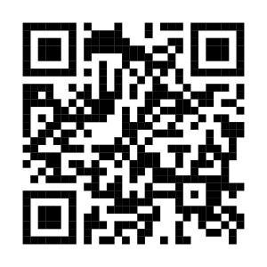
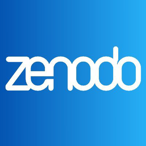
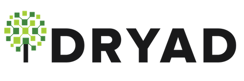
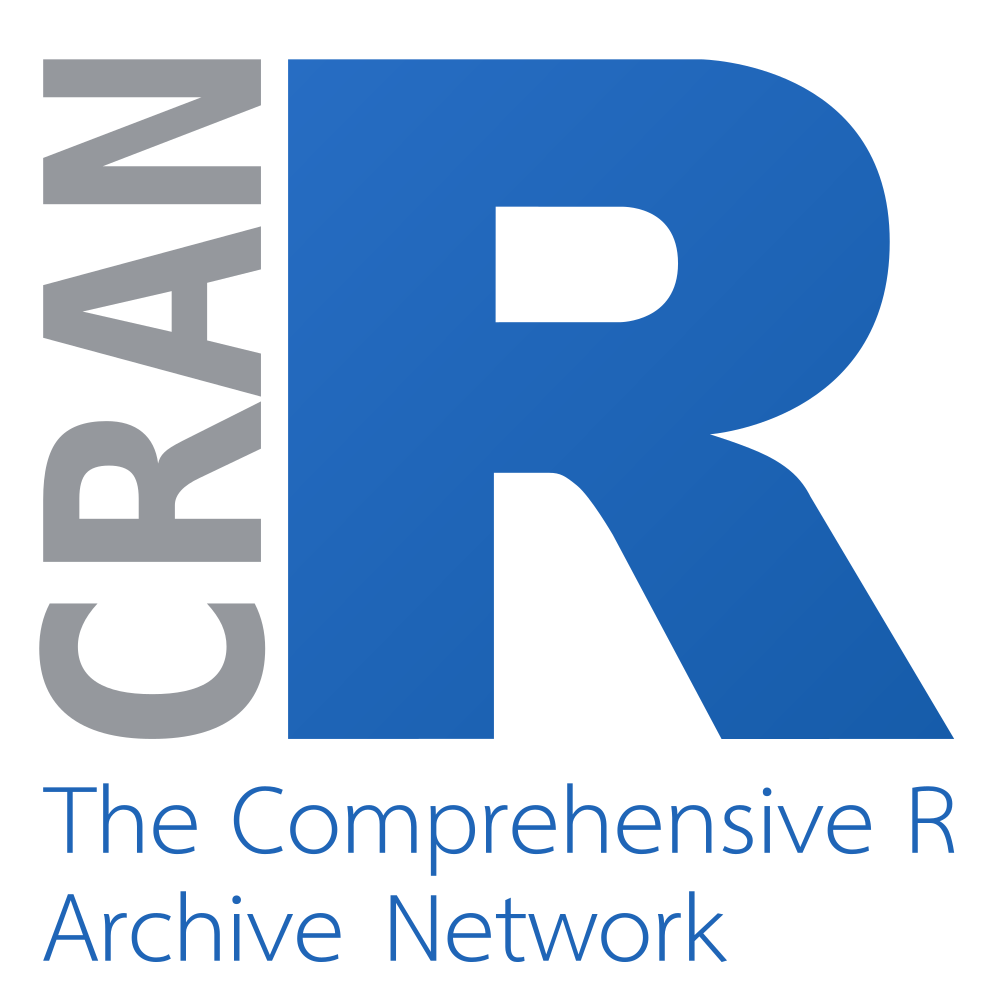
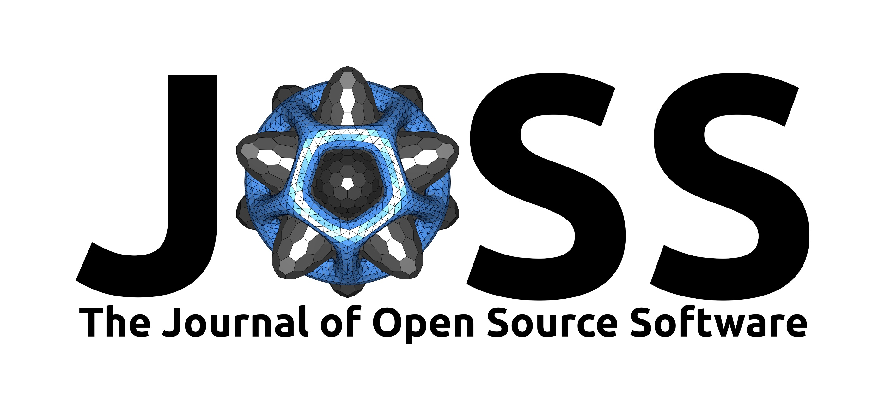

```{r}
#| include: false
url <- "https://debruine.github.io/talks/credit-data-2026/"
subtitle <- sprintf("[%s](%s)", url, url)
# make QR code
qrcode::qr_code(url) |> qrcode::generate_svg("images/qrcode.svg")

library(tidyverse)
set_theme(theme_bw())
```
---
title: "Getting Credit for Data and Software"
subtitle: "`r subtitle`"
author: "{width=300}"
format: 
  revealjs:
    logo: images/or_logo.png
    theme: [default, ../style.scss]
    transition: none
    transition-speed: fast
    df-print: kable
    code-annotations: select
execute:
  warning: false
---

```{r, include = FALSE}
knitr::opts_chunk$set(echo = TRUE)
```

# Abstract

This talk covers why and how you can get credit for your research data and software. Projects on GitHub or other repositories should contain a README, License, citation info, and stable releases. This can facilitate the creation of a DOI with Zenodo or other methods. Tools can also be described in a software paper. These objects can and should be included in Enlighten. 

## Why credit data and software?

* Transparency
* Funder requirements
* So you can cite your materials
* So other people can find and use your materials
* Responsible Recognition: We value diverse scholarly outputs beyond standard articles, including datasets, software, protocols, and code ([DORA](https://sfdora.org)) 


## Software

See [Getting Credit for Tool Creation](https://debruine.github.io/talks/tool-credit-2026) for advice on software repositories and what they should contain:

* README
* Clear role descriptions with ORCiDs
* Explicit License
* Citation info
* Stable Release(s)

# Get a DOI

A Digital Object Identifier is a unique and permanent ID used to identify academic papers, journal articles, and other digital data objects.

## Zenodo

:::: {.columns}
::: {.column width="67%"}
* Get a [Zenodo](https://zenodo.org) account
* Link your GitHub account
* Sync your repositories
* Enable a repository
* Create a release on GitHub
* Get your Zenodo DOI(s) and badge
* Publish a new release for each version
:::

::: {.column width="33%"}

:::
::::

## Other Repositories

You can archive a version of your software in a repository that provides DOIs, such as [Figshare](https://figshare.com/) or [Dryad](https://datadryad.org/).

This is more suitable for software that is no longer maintained or under development.

::: {layout-ncol=2}



:::

## CRAN

:::: {.columns}
::: {.column width="67%"}

If you write R packages, accepted CRAN submissions now get a DOI automatically.

<https://doi.org/10.32614/CRAN.package.faux>

:::
::: {.column width="33%"}

:::
::::

## JOSS

:::: {.columns}
::: {.column width="67%"}

* [Journal of Open Source Software](https://joss.theoj.org/)
* Paper with software description
* Links to code repository
* Paper and code reviewed via GitHub issues
* [Submission](https://joss.readthedocs.io/en/latest/submitting.html)

:::
::: {.column width="33%"}

:::
::::

## Data repositories

* [OSF](https:/osf.io): is no longer accepting new projects, all repositories are read-only by February 19, 2027
* [Zenodo](https://zenodo.org/): only for open data, run by CERN so not GDPR
* [UK Data Service](https://ukdataservice.ac.uk/): good for restricted data
* Discipline-specific repositories are always ideal
* Contact [Research Data Management](https://www.gla.ac.uk/myglasgow/openresearch/researchdatamanagement/repositoriesforfinaliseddata/) for complex needs


# Enlighten

Just like accepted papers, you should track your datasets, code, software, and any research object with a DOI on [Enlighten](https://researchdata.gla.ac.uk/deposit.html).

[Research Data Management](https://www.gla.ac.uk/myglasgow/openresearch/researchdatamanagement/)

# Thank You!

Getting Credit for Data and Software

`r subtitle`

{width=300}

